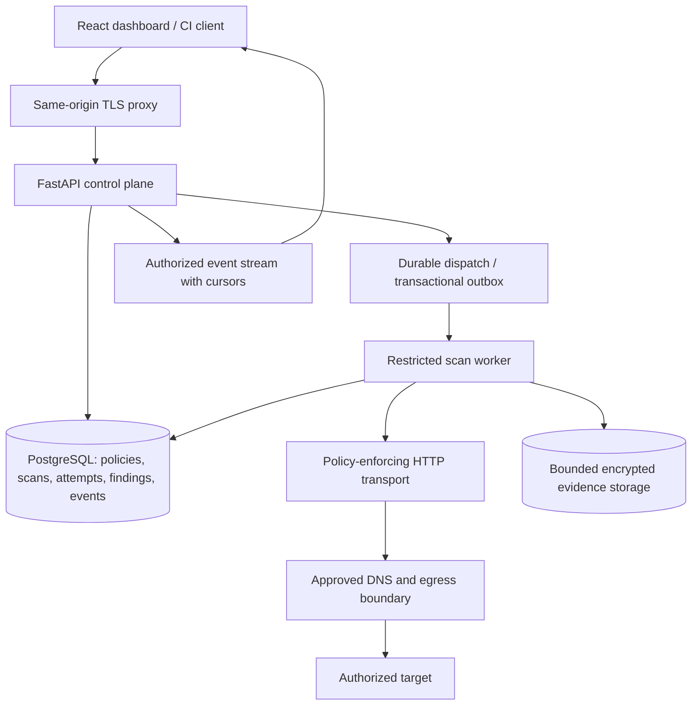

# SentinalScan: industry readiness audit and upgrade roadmap

**Audit date:** 31 October 2026, Asia/Karachi.  
**Baseline commit:** `b3fe31577bd1f4a89233ff33f5f16ed5f79ee7cd`.  
**Scope:** the current working tree, including the frontend changes and untracked frontend source already present when the audit began. This is not an audit of the commit alone. Application source was not changed by this audit.

**Verdict:** SentinalScan is a functional prototype with a usable dashboard and a reasonable small-codebase foundation. It is not ready for unattended scanning of real business systems or deployment as a shared production service. The release blockers concern outbound request safety, unintended state changes, false assurance, and loss of scan state. Adding more detectors, a queue, or AI triage alone would not resolve them.

The recommended first product is a **self-hosted, single-organization scanner for authorized staging environments**, with explicit scan policies, reproducible evidence, durable history, and CI integration. A multi-tenant commercial service is a later scope with additional isolation requirements.

## 1. Evidence and limitations

The review covered all backend application modules and tests; frontend API, state, streaming, report utilities, primary views, custom select, and styling/configuration; Docker and Compose; CI; dependency manifests and lockfile; and the existing audit/planning documents.

| Check | Observed result | Interpretation |
| --- | --- | --- |
| Backend pytest suite | 28 passed, 6 warnings | Existing tests pass. Outbound scanner HTTP was disabled through a temporary `httpcore.AsyncConnectionPool.handle_async_request` patch; MockTransport tests still ran. This is not a real target scan. |
| Backend Ruff | Passed with local Ruff 0.15.20 | This older default rule set did not establish parity with CI's subsequently installed Ruff 0.17.3; see the follow-up below. |
| Backend Bandit | Passed, no medium/high findings | Does not establish scanner scope safety or detection accuracy. |
| Frontend unit tests | 4 passed | Tests cover URL links, exports, and demo consistency; they do not test React components or streaming hooks. |
| Frontend ESLint | Passed | No lint errors observed. |
| Frontend production build | Passed | Vite 7.3.3; JS approximately 345 kB / 111 kB gzip; CSS approximately 87 kB / 18 kB gzip. Build warned about old Browserslist data. |
| Additional offline probes | 13 observations reproduced | Confirm current undesired behavior using MockTransport and mocked DNS. Assertions are audit evidence, not remediation regression tests. |
| Resolved Python dependency audit | 28 advisory records affecting 2 packages | The result contains duplicate advisory IDs: 14 distinct IDs, 7 each for `python-multipart` and `starlette`. Counts are not confirmed exploitable application vulnerabilities. |
| npm lockfile audit | 21 affected package entries: 11 high, 9 moderate, 1 low | Includes development/build dependencies and transitive effects. Not 21 demonstrated production exploits. |
| Docker runtime | Not tested | Docker executable is unavailable in this environment. Container findings are source inspection results. |
| Browser interaction, load and detection benchmark | Not performed | Build success does not establish accessibility, visual correctness, scanner precision/recall, production capacity, or restart resilience. |

Local runtime: Python 3.11.9, Node 22.23.2, npm 11.12.1. CI/container declarations use Python 3.12 and Node 20; those exact runtime combinations were not executed here. The initial root-directory pytest invocation failed to import `app`; the documented backend-directory invocation passed. Windows sandbox execution initially stalled while creating asyncio's local socketpair; the successful run used the same tests outside that sandbox with scanner HTTP disabled. That stall is an environment limitation, not evidence of an application defect.

**Follow-up, 1 November 2026:** GitHub Actions run `41183137744` installed unpinned Ruff 0.17.3 and failed with 142 lint errors under its expanded defaults. Reproducing that exact version confirmed the discrepancy with the earlier local lint result. The CI repair pins Ruff/Bandit, enforces the Ruff version in project configuration, fixes the reported lint issues, and strengthens the WebSocket assertions. This follow-up does not close the scanner safety or architecture findings below.

Reproducible evidence files:

- `reports/audits/industry_audit_probes.py`: standalone offline reproduction harness.
- `reports/audits/industry-audit-observations-2026-10-31.json`: captured probe output.
- `reports/audits/dependencies-python-2026-10-31.json`: full resolved Python advisory response.
- `reports/audits/dependencies-npm-2026-10-31.json`: full npm advisory response.
- `reports/audits/industry-audit-source-manifest-2026-10-31.json`: hashes identifying the reviewed source snapshot.

Dependency input SHA-256:

```text
backend/requirements.txt
cf9b79c36ebb359160b7bb19299a435e376552be6a2c2813db2e3b8b9575dadf

frontend/package-lock.json
ddeb19b4a5db389e540c8c385f5635a9bd7cf16a25916a4cc953a7863bc6e679
```

No external application was vulnerability-scanned. The local dependency checks queried public package advisory services. Actual private `.env` contents were not read, and no live credentials were used in the probes.

## 2. What is already worth keeping

- Small, understandable FastAPI service, Pydantic boundary models, and async HTTP implementation.
- A plugin abstraction and shared HTTP session, which can be retained behind a safer transport interface.
- REST and WebSocket authentication, constant-time key comparison, rejection of known default/short API keys, default TLS verification, and conservative default private-target blocking.
- Explicit same-host redirect handling in the crawler, tracked scan tasks, cancellation support, and incremental findings.
- A dashboard with useful filters, finding details, history, error states, demo labeling, and JSON/CSV export.
- React text rendering and allowed-scheme finding links; CSV formula neutralization and allowlisted JSON scan metadata have focused tests.
- Existing backend tests, frontend lint/build checks, CI, environment examples, and centralized application version.

Several older findings have been fixed: the WebSocket is authenticated, API key comparison is constant-time, result lists use factories, task tracking exists, stopped scans are generally preserved, and crawler redirects are manually checked. Those historical problems should not be repeated as current findings. The older reports remain useful background, but the current code is the authority.

## 3. Prioritized findings

Priorities below are implementation urgency, not CVSS ratings. **P0** blocks further real active scanning; **P1** blocks a credible production release; **P2** should be addressed before a wider operational rollout; **P3** improves maintainability and adoption. Deployment-dependent findings state their conditions explicitly.

### SS-01 — P0: plugins bypass the outbound safety boundary

**Evidence:** `backend/app/services/scanner/engine.py:34` obtains the raw crawler client and passes it into every plugin. XSS (`plugins/xss.py:32,53`), SQLi (`plugins/sqli.py:47,71`), headers (`plugins/headers.py:82`), and sensitive-file probes (`plugins/sensitive_files.py:65`) issue requests directly rather than through `WebCrawler.safe_get` or equivalent policy validation. Form actions are resolved from target-controlled HTML.

**Reproduced:** the real engine's initialized XSS and SQLi plugins made mocked requests to a loopback form action and to an excluded path. The loopback POST carried both a placeholder bearer token and a placeholder cookie. There were 22 recorded requests across the cases. No real loopback service was contacted.

**Impact:** the crawler's advertised SSRF, origin, and exclude protections do not constrain the full scanner. An approved page can redirect plugin requests to another destination and expose supplied target credentials. Redirect-following being disabled does not prevent a direct cross-origin form action.

**Upgrade:** replace the exposed `httpx.AsyncClient` with a `ScanHttpClient.request()` interface that is the only outbound route for every method, plugin, crawler, browser adapter, and future integration. Enforce policy at send time, including origin, port, address, path, credentials, budgets, response limits, and cancellation. Plugins receive capabilities, not a raw client.

**Acceptance:** instrument the connector and prove that disallowed forms, redirects, alternate methods, and sensitive-file probes produce zero outbound connections and zero credential transmissions. Include excluded paths and a DNS-changing destination.

### SS-02 — P0: active probing can change application state

**Evidence:** XSS and SQLi automatically submit discovered POST forms. Non-target fields are replaced with `test` or `1`; there is no passive-only mode, plugin selection, allowed-method policy, action classification, or server-recorded authorization scope. The frontend authorization checkbox is not part of the API's stored contract.

**Impact:** even a payload without destructive SQL can submit a purchase, create a user, send email, reset credentials, or change settings. Payload wording cannot make arbitrary POST forms read-only. GET requests can also have application side effects.

**Upgrade:** introduce explicit `passive`, `safe-active`, and `custom-active` policies. Passive analysis inspects captured traffic without form submission; even crawl requests need approved scope. Active policies must define permitted endpoints/methods and exclude logout, checkout, deletion, payment, and account recovery by default. Preserve ordinary form values and anti-CSRF tokens. Store who authorized the policy, its version, scope, and expiry on the server.

**Acceptance:** fixtures with state-changing handlers remain unchanged under passive/default policy. Approved active requests require a matching stored policy and produce an auditable request record. Do not describe the scanner as non-destructive without these controls and qualified limitations.

### SS-03 — P1: crawler address and origin validation has gaps

**Evidence:** `crawler.py:96` resolves the hostname, then `safe_get` lets HTTPX independently connect; the approved answer is not bound to the connection. Network checks cover a short list of CIDRs, not all non-public address classes. Origin comparisons at `crawler.py:141,190,216` compare `netloc`, omitting scheme.

**Reproduced:** a HTTPS target accepted a HTTP request on the same hostname. Mocked DNS answers containing IPv4-mapped loopback, IPv4-mapped metadata, IPv4 multicast, IPv6 unspecified, and IPv6 multicast passed `_is_safe_ip`. These are validation acceptance results; no connection to those addresses was attempted. DNS rebinding remains an architectural exposure identified by inspection, not a live exploit demonstrated here.

**Upgrade:** compare normalized `(scheme, hostname, effective_port)` origins. Classify both address families, normalize IPv4-mapped IPv6, reject ambiguous/empty DNS answers, and use a transport/proxy that connects only to approved addresses while preserving correct Host/SNI/certificate verification. Disable uncontrolled environment proxy routing or validate the approved proxy path. Apply network egress restrictions outside the process as defense in depth. Internal scans should use an administrator-approved internal worker/network profile, not only a client-supplied boolean.

**Acceptance:** deterministic rebinding tests verify the actual connection destination. Cover mapped addresses, multicast, unspecified, reserved ranges, mixed A/AAAA answers, scheme downgrade, alternate ports, and redirects. OWASP's [SSRF prevention guidance](https://cheatsheetseries.owasp.org/cheatsheets/Server_Side_Request_Forgery_Prevention_Cheat_Sheet.html) supports application validation combined with network restrictions.

### SS-04 — P1: page limits do not bound memory, traffic, or scan duration

**Evidence:** `crawler.py:207` eagerly downloads the body; the two-megabyte check occurs only afterward at `crawler.py:306`. Plugins read unrestricted response text. Page concurrency surrounds a gather of multiple plugins (`engine.py:141`), so `workers` is not a global request-concurrency or rate limit. There are no global request, byte, elapsed-time, or per-form field budgets. Logs and scan history grow without expiry.

**Reproduced:** a streamed three-megabyte mocked body was completely consumed before a two-megabyte cap rejected it.

**Impact:** an untrusted target can exhaust scanner resources or induce excessive traffic. Caching 500 pages near the nominal cap alone approaches one gigabyte of content before decoded strings, parsing, evidence, and logs. A page with many forms/inputs generates far more requests than `max_pages` suggests.

**Upgrade:** stream responses and abort at raw and decoded/decompressed byte limits; cap aggregate bytes, requests, redirects, fields, payloads, elapsed time, and cache size. Use one shared request semaphore and per-origin rate limiter across plugins. Handle 429/503 and Retry-After with bounded backoff and circuit breaking. Bound queues, logs, event retention, browser resources, and API payloads.

**Acceptance:** oversized and compressed-body fixtures abort before full consumption; request counts and concurrent sends never exceed policy. A long-running or adversarial fixture terminates within the scan deadline and records why coverage ended.

### SS-05 — P1: incomplete scans can look successful

**Evidence:** `_fetch_page` converts connection/parser errors into `None` (`crawler.py:329` onward). Crawl queue timeout returns the pages obtained so far. Plugin errors are logged but do not establish a degraded result (`engine.py:141` onward). `_pages_scanned` increments in `finally`, even on page failure. The manager assigns COMPLETED whenever the engine returns normally (`manager.py:139`).

**Reproduced:** a real manager/engine run with every mocked HTTP request raising `ConnectError` ended with `status=completed`, zero scanned pages, and zero findings.

**Impact:** an operator or CI consumer can confuse lack of execution with lack of vulnerabilities. Pages scanned is also an attempt counter in some paths rather than a successful coverage metric.

**Upgrade:** separate execution state from assessment completeness. Store attempted/succeeded/skipped/failed pages and per-rule states such as `executed`, `not_applicable`, `blocked`, `timed_out`, and `error`. Represent incomplete coverage explicitly, with reason codes. Require minimum target reachability and selected-rule completion for a successful assessment; define CI behavior for incomplete scans separately from finding thresholds.

**Acceptance:** DNS, TLS, authentication, robots, content-size, parser, plugin, and deadline failures cannot produce an unqualified clean assessment. The UI and exports display coverage and limitations beside finding counts.

### SS-06 — P1: XSS and SQLi confirmation logic is too weak

**Evidence:** XSS uses a substring check (`plugins/xss.py:57`) with no HTML context or executable content-type assessment. SQLi searches each response for error patterns (`plugins/sqli.py:75`) without comparison to the original page or a control request. Both default to High confidence and fixed severity scores.

**Reproduced:** JSON containing a reflected script string produced High-severity, High-confidence XSS. An unchanged baseline page containing an existing SQL error produced Critical-severity, High-confidence SQL injection.

**Upgrade:** separate observations, suspected vulnerabilities, and validated findings. For XSS, retain unique markers and analyze reflection context/encoding/content type; isolate any browser confirmation in a restricted worker. For SQLi, compare baseline and control responses, normalize dynamic content, and require a repeatable differential. An existing error should be classified as possible information disclosure, not automatically injection. Riskier confirmation methods need a separate policy.

**Acceptance:** a versioned corpus of vulnerable and safe fixtures produces expected rule outcomes. Track per-rule precision, recall, inconclusive cases, and requests used. JSON reflections, harmless text rendering, and unchanged SQL-error pages are mandatory negative cases.

### SS-07 — P1: no durable execution or history

**Evidence:** `manager.py:48` stores scans, tasks, engines, and logs in process-local dictionaries. Work starts with `asyncio.create_task` in the API process. There is no database, migration system, durable queue, checkpoint, lease, or worker recovery model.

**Impact:** restart loses history and results. Multiple API workers have different state and independent single-scan locks, so status/stop requests can reach a process that does not own the scan. Scaling Uvicorn workers now would break correctness.

**Upgrade:** add PostgreSQL and migrations first. Persist a scan request, immutable policy snapshot, execution attempt, events, findings, and evidence references. Then move execution into a dedicated worker with durable job claiming/leases. A broker can be introduced for dispatch, but PostgreSQL remains the source of truth. Handle duplicate delivery and orphan recovery explicitly; never blindly retry a state-changing request after a crash.

**Acceptance:** API/worker restart preserves findings and reaches an explainable state. Duplicate dispatch creates one logical result. Stop works through any API instance, leases expire safely, and an interrupted active request is recorded as uncertain rather than replayed automatically.

### SS-08 — P1: Docker builds can include local secrets

**Evidence:** backend Dockerfile uses `COPY . .` at line 30, with `./backend` as its build context. There is no backend `.dockerignore`. The documented workflow creates `backend/.env` before the Compose build. Git ignore rules do not filter Docker build contexts. Frontend also lacks a Docker ignore file.

**Impact:** following the documented setup can copy a real backend `.env` into the final image. This is a configuration-based finding; an actual image containing a secret was not built or inspected.

**Upgrade:** add context-specific `.dockerignore` files excluding `.env*` while retaining only necessary examples, virtual environments, caches, test artifacts, node_modules, and reports. Prefer copying only application/runtime files into the final image. Supply secrets at runtime through an appropriate secret store or mounted secret.

**Acceptance:** build with a harmless sentinel `.env` and inspect image contents/layers to prove it is absent. Run the packaged application using only runtime configuration.

### SS-09 — P1 for shared deployment: one global key is not user authorization

**Evidence:** all scan routes depend on the same `get_api_key`; scans have no owner, organization, role, asset registration, or project policy. Anyone with the key can enumerate results, stop scans, and choose private-target opt-in. Key validation verifies minimum length and known-default rejection; the startup message's claim of checked entropy is stronger than the implementation.

**Upgrade:** for a local single-operator release, document and enforce that boundary with restricted network exposure and scoped keys. Before shared deployment, add identities, organization/project membership, roles, per-object authorization, key identifiers/hashes/scopes, expiry, revocation, and rotation. Approve assets and internal worker profiles administratively. A UI checkbox is useful acknowledgment but not proof of asset control.

**Acceptance:** separate users/projects cannot read, stop, stream, or export each other's scans. Scope is checked server-side at enqueue and request execution. Avoid adding JWT/session configuration without an implemented lifecycle; `SECRET_KEY` and token expiry settings currently do not provide those features.

### SS-10 — P1: credentials can appear in URLs, logs, and client state

**Evidence:** the long-lived API key is placed in the WebSocket query string (`main.py:76`, `useLiveLogStream.js:109`). No WebSocket Origin check or connection quota is present. Scanner log capture includes HTTPX logs; target URLs and query parameters can enter logs. `SensitiveDataSanitizer` only regex-masks selected JSON string fields; it is not a logging filter and does not sanitize nested arbitrary values or URL query secrets. UI credentials and log snapshots use sessionStorage. `VITE_API_KEY` remains an optional public build-time fallback.

**Reproduced:** a placeholder `api_key` inside a log message URL survived the current redaction path. This is separate from SS-01's demonstrated credential forwarding.

**Upgrade:** use short-lived, scan-scoped, preferably single-use WebSocket tickets issued over authenticated HTTPS, or a same-origin session design with suitable CSRF controls. Validate Origin and authorize the scan. Redact secrets structurally before logs/evidence are persisted or broadcast, including query parameters, headers, cookies, and nested values. Encrypt retained target credentials and give them short retention. Remove build-time shared keys from production configurations; clear credential-related client caches on logout/rotation.

**Acceptance:** automated sentinel tests find no credentials in logs, exports, URLs, client bundles, or proxy records. Rotation invalidates old access. WebSocket tickets expire and cannot access a different scan. Use [OWASP WebSocket security guidance](https://cheatsheetseries.owasp.org/cheatsheets/WebSocket_Security_Cheat_Sheet.html) for transport, origin, authentication, and resource controls.

### SS-11 — P1: dependency vulnerability and reproducibility backlog

**Evidence:** backend pins include FastAPI 0.110.0, Starlette resolving to 0.36.3, and python-multipart 0.0.9. The saved resolved audit has 14 distinct advisory IDs across the latter two packages, emitted as 28 records. npm reports 21 affected package entries. Python runtime dependencies lack a complete hash-locked transitive graph. CI tools and the globally installed frontend `serve` package are unpinned.

**Reachability matters:** the reviewed API uses JSON requests; no multipart parsing endpoint or file-serving endpoint was identified. Do not call every Starlette/multipart advisory remotely exploitable here. Three npm affected entries are in the lockfile's production dependency graph (`axios`, `follow-redirects`, `form-data`); the remaining 18 are marked dev. That graph distinction does not prove vulnerable Node-specific code is present or reachable in the browser bundle.

**Upgrade:** remove unused packages such as multipart support if unnecessary, update FastAPI and its compatible Starlette/Pydantic stack together, and lock the resolved graph with hashes. Update the frontend lockfile using compatible releases and manually review major changes. Add automatic dependency update proposals, advisory checks, container scans, and an SBOM. Time-bound exceptions must identify reachability and ownership. Do not apply `npm audit fix --force` without compatibility review.

**Acceptance:** fresh locked installs pass tests/build and advisory policy; any exceptions have evidence and expiry. Keep build-tool risk separate from browser runtime risk. For independently verified examples, see the maintainer advisories for [python-multipart parsing DoS](https://github.com/Kludex/python-multipart/security/advisories/GHSA-59g5-xgcq-4qw3) and [Starlette multipart DoS](https://github.com/Kludex/starlette/security/advisories/GHSA-f96h-pmfr-66vw). Their historical first-fixed versions are not a sufficient current upgrade target.

### SS-12 — P2: URL rewriting and robots handling change scan semantics

**Evidence/reproduction:** URL validators sort query pairs, strip trailing slashes, discard path parameters, and reconstruct authorities without IPv6 brackets (`models/scan.py:31`, `crawler.py:81`). `https://approved.invalid/app/?step=2&step=1` became `https://approved.invalid/app?step=1&step=2`; a valid bracketed IPv6 authority lost its brackets. These operations can alter repeated-parameter semantics, signed URLs, routing, and relative-link resolution.

`crawler.py:227` appends `/robots.txt` to the full target URL rather than the origin. The probe fetched `/app/robots.txt`, then fetched the seed despite its returned `Disallow: /`. Robots checks occur during link discovery rather than on all sends. The crawler's fixed ten-second queue join timeout can cancel an in-flight tail request even when the configured timeout allows longer; page reservations also ignore in-flight work when admitting new links.

**Upgrade:** preserve the exact request URL separately from a conservative deduplication key. Keep bracketed IPv6 and meaningful path/query ordering. Use the origin's `/robots.txt`, check seed and subsequent requests consistently under the chosen policy, and define behavior for unavailable robots data. Use bounded queue accounting that includes in-flight work and one explicit scan deadline.

**Acceptance:** fixture graphs cover slash-sensitive routes, repeated query keys, signed URLs, base tags, redirects, IPv6, robots-disallowed seed pages, slow tail requests, and page-budget boundaries.

### SS-13 — P2: discovery and input coverage are narrow

**Evidence:** only static HTML anchors and forms are discovered. JavaScript-rendered routes, API schemas, JSON request bodies, login workflows, session refresh, and browser traffic are not covered. SQLi/XSS focus on form fields rather than an inventory of query/body/path/header inputs. Existing form values are overwritten; select controls, multiple same-name fields, submitter semantics, and encodings are not faithfully modeled.

**Upgrade:** create a normalized endpoint/input inventory recording provenance and authentication context. Add query and JSON-body support, sitemap ingestion, and OpenAPI import. Then add an optional isolated browser crawler that shares the same scope/egress rules. Add login verification and session-expiry detection before claiming authenticated coverage. Store target secrets as references, not embedded plaintext in job messages.

**Acceptance:** versioned fixtures demonstrate exactly which endpoints and inputs each discovery mode covers. Unsupported classes are shown as not tested. Multi-identity authorization testing requires explicit user/role contexts; a numeric URL alone cannot establish IDOR.

### SS-14 — P2: passive rules create noise and miss context

**Evidence/reproduction:** a normal `robots.txt` produced a Medium 5.0 sensitive-file finding and removal advice. Absence of deprecated `X-XSS-Protection` produced a Low finding despite an otherwise restrictive header set. CSRF detection relies on hidden-field names and ignores other mitigations and the request's authentication context. Security-header deduplication keeps only the first occurrence per name, losing affected endpoints. CSP/HSTS validation uses coarse string checks rather than directive semantics.

**Upgrade:** distinguish public metadata from exposed secrets. Compare sensitive-file responses with randomized missing-path controls and use file-specific signatures. Make uncertain CSRF findings review observations. Recognize CSP `frame-ancestors` when assessing framing protection; evaluate HSTS/CSP directives with context. Group equivalent observations while retaining all affected locations. Retire missing-X-XSS-Protection warnings; [MDN documents the header's deprecated status](https://developer.mozilla.org/en-US/docs/Web/HTTP/Reference/Headers/X-XSS-Protection).

**Acceptance:** safe fixtures with normal robots/manifests, modern framing policies, tokenless alternative CSRF protections, custom 404s, and route-specific headers have expected outcomes.

### SS-15 — P2: finding records are insufficient for triage and retesting

**Evidence:** the model (`models/vulnerability.py:25`) contains strings and a score, but no finding ID, rule ID/version, input location/name, method, evidence reference, confidence basis, verification status, CWE/WSTG mapping, CVSS vector, or remediation lifecycle. Deduplication uses URL/type/description, so prose changes change identity. Severity/confidence defaults imply more certainty than several rules establish.

**Upgrade:** give findings stable identities and structured evidence. Separate rule observations from findings and from verification decisions. Preserve request/response references, redacted excerpts, content types, baseline comparison, scope, engine/rule versions, and affected instances. Add statuses such as open, confirmed, false-positive, accepted-risk, fixed, and regressed with reviewer attribution. Version the report schema and policy.

**Acceptance:** the same issue retains identity across scans and can be retested without rerunning unrelated probes. Scores are labeled heuristic unless backed by a defined [CVSS vector and version](https://www.first.org/cvss/v4.0/specification-document). Every high-confidence claim has evidence supporting that confidence.

### SS-16 — P2: repeated full-data polling and stale async log writes

**Evidence:** scan history returns full `ScanResponse` objects with results; status also returns results plus up to 300 logs; separate results/log endpoints return full arrays. The UI polls history every five seconds, status during scanning every 1.5 seconds, and results every three seconds. The log hook reconciles all REST logs every 1.5 seconds even with a working WebSocket and continues while mounted after completion. Its in-memory list and deduplication set are unbounded; only the sessionStorage snapshot is sliced to 1,000.

In `useLiveLogStream.js:78`, an in-flight REST request is not aborted or checked against `cancelled` before append. Storage uses mutable `scanIdRef.current`, so an old scan's response can be written into a newly selected scan's log state/storage. This race is source-supported; it was not exercised in a browser test during this audit. The WebSocket effect does not depend on credential identity, so saving a new key does not itself rebuild an existing socket for the same scan.

**Upgrade:** separate summary/status/result DTOs, paginate findings/history, and sequence events with `after` cursors. Use bounded client buffers and table virtualization when needed. Cancel obsolete requests, reject late responses by scan ID/generation, stop terminal polling, and reconnect streaming on authentication changes. Use one authoritative event reconciliation path rather than repeated full replay.

**Acceptance:** switching scans under delayed responses never mixes logs. Long scans remain within memory/response-size budgets. API traffic is proportional to new events, not all historical findings and logs.

### SS-17 — P2: cancellation and shutdown have lifecycle gaps

**Evidence/reproduction:** immediately stopping a PENDING scan before `_run_scan` enters leaves its cancelled task in `manager.tasks`, because cleanup only occurs in `_run_scan`'s `finally`. Existing cancellation tests cover an already-running fake engine. Application lifespan shutdown logs a message but does not explicitly drain/cancel tracked work or persist interruption status. Global log handlers would also mix scan logs if concurrency were increased without redesign.

**Upgrade:** move task cleanup into an owner-controlled callback/finalizer that handles tasks cancelled before entry. Implement explicit lifecycle transitions, shutdown draining, and interrupted-attempt recording. Use scan-context logging instead of attaching per-scan handlers to broad global loggers.

**Acceptance:** pending/running/repeated stop, disconnect, startup failure, and shutdown leave no orphan tasks or clients. Concurrent workers never mix event ownership.

### SS-18 — P2: some passing tests do not assert their stated guarantees

**Evidence:** `test_security_hardening.py:29` catches `Exception` around a block that raises its own `AssertionError` if an unauthenticated socket connects. The test therefore also passes when the assertion detects broken authentication. The authenticated WebSocket test opens a missing scan and closes it; it does not verify streaming completion despite its name. No existing direct XSS/SQLi correctness tests or end-to-end real-engine safety tests were found. CI does not run the four frontend unit tests.

**Upgrade:** assert exact disconnect codes and successful message sequences; remove catch-all assertion swallowing. Stub all external HTTP/DNS in unit tests explicitly. Add integration tests exercising the real engine through policy transport, plus browser tests for start/stop/results/stream fallback and scan switching. Add frontend test execution to CI. Use targeted coverage thresholds for critical safety/transition paths, not a blanket coverage percentage as a quality claim.

**Acceptance:** deliberately breaking WebSocket authentication or plugin scope makes the relevant tests fail. Positive and negative detector fixtures are both required. A benchmark reports rule-specific results against a fixed corpus, not just a total test count.

### SS-19 — P2: deployment and operations are development-oriented

**Evidence:** images have no explicit non-root USER; backend copies the full context; frontend installs an unpinned global server. Compose exposes both services directly, lacks health checks/resource limits, and hardcodes browser URLs to localhost. These URLs work for a browser on the deployment host but point to the wrong machine for a remote operator. There is no TLS/reverse-proxy configuration, readiness distinction, metrics, tracing, backup/restore, retention/deletion workflow, or recovery runbook. JSON response middleware buffers and rewrites every JSON body using `body += chunk`, compounding large-response overhead.

**Upgrade:** provide separate development and production profiles. Serve frontend/API/streaming through a same-origin TLS proxy, use non-root minimal images, pinned inputs, health/readiness checks, resource limits, least-privilege networks and egress controls. Use structured redaction at the data/log boundary instead of globally rewriting JSON. Add metrics for request counts, coverage failures, queue age, rule latency, budgets, worker heartbeat, and cancellation. Define retention, secure deletion, backups, restore drills, incident response, and supported runtime versions.

**Acceptance:** a clean host can deploy the documented production profile; readiness fails when required dependencies are unavailable; worker loss and restore are exercised; secrets are absent from images/logs; operational limits are measurable.

### SS-20 — P2: frontend maintainability and assurance need strengthening

**Evidence:** the current working-tree `App.jsx` is approximately 1,257 lines and `index.css` approximately 5,180 lines. API shapes are untyped JavaScript and broad view/state responsibilities share one component. Custom select and modal keyboard behavior are substantial application code without interaction tests. External Google Fonts require network access. Errors from the API and browser are not tied to an operational request ID.

**Upgrade:** extract application shell, overview, settings/onboarding, report view, and dialog primitives along current feature boundaries. Introduce TypeScript gradually, generated OpenAPI client types, and runtime handling for unexpected/older API schemas. Establish design tokens and retire unused styles after usage verification. Add keyboard/screen-reader, contrast, reduced-motion, responsive, and large-data tests. Self-host fonts for predictable offline/internal deployment. Ensure backend validation errors can be correlated with request IDs without leaking credentials.

**Acceptance:** component and browser tests cover key entry/rotation, form validation, custom controls, async scan switching, terminal states, errors, and exports. Do not use a visual redesign as a substitute for backend correctness.

### SS-21 — P3: documentation and distribution need one maintained contract

**Evidence:** several reports/plans describe historical code or future capabilities. `task_phase#4.md` proposes Celery/Postgres/Anthropic work, but no corresponding runtime implementation exists. No tracked root license, security disclosure policy, contribution guide, supported-environment matrix, or release procedure was found. Configuration defaults such as DEFAULT_MAX_PAGES are defined in Settings but request defaults remain separately hardcoded; some future signing settings are unused.

**Upgrade:** keep one current architecture document, threat model, supported-feature matrix, versioned API/report contract, operations guide, changelog, and release checklist. Mark historical audits as snapshots with dates and supersession links. Choose a license deliberately and add a vulnerability disclosure route. Remove unused configuration or wire it through validated defaults. Keep an explicit unsupported/not-tested matrix rather than allowing enum names such as IDOR/SSRF to imply implemented detectors.

**Acceptance:** a new operator can install a supported version, authorize a scope, run an assessment, interpret coverage/confidence, rotate credentials, and recover history using only current documentation.

## 4. Recommended architecture

Keep a modular monolith for the control plane and a separately deployed scanning worker. Separate processes provide resource and security isolation without introducing a microservice for every feature.



**Control plane:** authenticates operators; registers projects/assets; validates and versions policy; persists scan requests; exposes summary/results/events/report APIs; owns authorization and cancellation intent. It should not have unrestricted target-network access.

**Worker:** claims one durable execution attempt; enforces immutable policy; maintains budgets and credential isolation; records coverage and evidence incrementally. Place browser automation in a further restricted process/container. Treat scanned content as hostile, including content later passed to report templates or optional AI.

**Storage:** PostgreSQL owns durable state. Suggested entities: organization/project, asset, scope policy/version, credential reference, scan, execution attempt/lease, endpoint/input, rule outcome, finding/instance, evidence reference, event/sequence, triage decision, report. Evidence blobs can initially use a bounded local mounted store for one deployment, with object storage added when operationally justified.

**Dispatch:** a PostgreSQL-backed worker with leases can serve a small installation. If using Celery with Redis or another broker, select it deliberately and define delivery/acknowledgment/recovery semantics. The broker is not the permanent record of scan truth. Add a transactional outbox or equivalent to avoid the database-save/enqueue gap. Deduplicate events/findings; do not assume task delivery is exactly once.

**Plugin contract:** include stable ID/version, category, capabilities/methods, risk level, input types, limits, execution prerequisites, evidence schema, and expected failure modes. Separate passive observations from active checks. Plugins never get direct sockets, arbitrary HTTP clients, database credentials, or unrestricted browser APIs.

**API evolution:** expose paginated scan summaries and finding instances, a small progress endpoint, cursor-based events, explicit policy IDs, and a versioned report endpoint. Return an accepted job response with a stable scan ID and support idempotency keys. Keep missing-resource semantics consistent; the current unknown-scan logs endpoint returns an empty list while status/results return 404. Version public schema changes and provide migration notes.

## 5. Upgrade roadmap with release gates

The order below matters more than calendar estimates. Rough effort ranges assume one experienced engineer working on this codebase; they exclude independent security review and expand if supported targets or tenancy requirements broaden. They are planning estimates, not delivery commitments.

| Stage | Work | Exit gate | Rough effort |
| --- | --- | --- | --- |
| A: safe execution | SS-01 through SS-05, SS-08, targeted SS-10/17/18; unified transport; passive/active policies; origin/address validation; bounded streaming/budgets; truthful outcomes; image exclusions | Real-engine negative safety suite passes; no unexpected sends or credential forwarding; incomplete scans cannot look clean; cancellation and budget tests pass | 2–4 weeks |
| B: trustworthy findings | SS-06, SS-12–15; baseline/control logic; evidence model; conservative rules; fixture corpus; scoped endpoint/input inventory | Every supported rule has positive/negative fixtures and reproducible evidence; reported confidence has a basis; unsupported coverage is visible | 3–5 weeks |
| C: durable internal pilot | SS-07, SS-09 as needed for pilot, SS-10/11/16/17/19; Postgres/migrations; worker leases; recovery; authorization; cursor events; production packaging | Restart, duplicate delivery, key rotation, access isolation, stop-through-any-API, retention and restore drills pass; dependencies meet release policy | 3–5 weeks |
| D: operational product | SS-13/20/21; selected authenticated/API/browser coverage; finding lifecycle/retests; reports/CI; documentation and observability | Named users complete a controlled pilot; measured precision/coverage/resource use; supported operating envelope and recovery procedure published | 4–8 weeks |

Dependency updates begin immediately and are verified during each stage. Persistence can be developed alongside detector improvements after the outbound interface is fixed. Do not add API-process concurrency or multiple API workers ahead of durable state and ownership.

**First implementation backlog, in order:**

1. Write real-engine regression cases for off-scope form actions, credential forwarding, excluded paths, and unsafe address answers; ensure they fail on the current implementation.
2. Introduce the only permitted HTTP request interface and route every existing plugin through it.
3. Add server-enforced policy profiles, allowed methods/endpoints, immutable scope records, and request/byte/deadline limits.
4. Replace eager downloads with bounded streaming; fix origin identity and URL preservation; qualify actual connection-destination enforcement.
5. Add coverage/error outcomes and make zero-page or failed-rule assessments visibly incomplete.
6. Exclude secrets from Docker contexts and begin compatible dependency upgrades; make advisory checks and frontend tests part of CI.
7. Correct XSS/SQLi confirmation and noisy passive rules using a fixed corpus.
8. Introduce structured findings/evidence, then persistence, durable worker execution, and operational recovery.

## 6. Features that would create real product value

| Upgrade | User benefit | Prerequisite |
| --- | --- | --- |
| Projects, approved assets, saved scan policies | Repeatable authorized assessments | Server-side ownership/scope and audit trail |
| Scheduled scans and CI integration | Detect regressions during releases | Durable jobs, meaningful incomplete/failure handling, stable IDs |
| Authenticated session profiles and API import | Reach application functionality that matters | Encrypted credential references and session-validity checks |
| Finding review, suppression with expiry, assignment, and retest | Reduce repeated noise and track remediation | Stable finding identities and reliable evidence |
| Scan-to-scan diffs and regression tracking | Show what changed and what was fixed | Versioned rules/policy and durable history |
| Versioned JSON plus useful human-readable reports; SARIF where appropriate | Integrate results into engineering work | Structured evidence, metadata, confidence and coverage |
| Signed/authorized webhooks and issue tracker integration | Route reviewed findings into existing workflows | Delivery retries, secret protection, and idempotency |
| Optional isolated browser discovery | Cover modern applications | The same enforced scope and egress boundary as HTTP checks |
| Carefully selected new checks | Broaden useful coverage | Positive/negative fixtures, policy classification, and evidence standards |

Start new rule coverage with well-scoped passive checks such as cookie attributes, TLS observations, and response configuration, then selectively expand active checks. Cross-origin policy tests, open redirects, authorization comparisons, and callback-based SSRF checks each need explicit scope and validation contracts. Business-logic and authorization weaknesses require appropriate identity/workflow context; they cannot be promised by increasing payload count.

**AI triage is optional and later.** The existing phase plan puts it next to core persistence/scaling work. It should not become a prerequisite or a substitute for detection evidence. If added, scanned content must be treated as untrusted input, secrets must be removed before external transmission, output must be labeled advisory and schema-validated, and the model must have no autonomous target-request capability. AI should explain/group evidence, not silently upgrade confidence, mark an issue fixed, or approve scope.

**Avoid premature expansion:** Kubernetes, many microservices, a large payload library, arbitrary dynamic plugins, and a new visual redesign do not address the current release blockers. First demonstrate controlled execution, reliable findings, durability, and operability for the supported deployment model.

## 7. Qualification plan

1. **Unit and property tests:** URL preservation, origin/address classification, scope matching, credential binding/redaction, request budgets, stable fingerprints, and lifecycle transitions. Generate edge cases for parsing and IPv6 rather than relying only on hand-picked examples.
2. **Real-engine integration tests:** malicious HTML form actions, redirect chains, DNS changes, oversized/decompressed streams, failed authentication, plugin exceptions, page-limit boundaries, and cancellation. Use isolated transports and assert actual sends; testing the crawler alone is insufficient.
3. **Detector corpus:** positive and negative fixtures for every supported rule, including JSON/text reflection, pre-existing SQL errors, dynamic content, modern CSP/framing, tokenless alternative CSRF protections, and soft 404s. Report per-rule precision/recall and inconclusive outcomes on that corpus. Set release thresholds before tuning against a held-out set; publish sample sizes and limitations.
4. **Durability/fault tests:** kill workers/API at enqueue, claim, fetch, finding publication, report generation, and stop. Test duplicate delivery, expired leases, uncertain active requests, broker/database outage, backup/restore, and migration/rollback procedures.
5. **Browser tests:** operator onboarding, credential changes, start/stop, late REST responses during scan switching, streaming fallback, terminal polling, coverage labels, accessibility, mobile layout, and exports.
6. **Load/resource tests:** run representative and adversarial targets in an isolated lab; record requests/second, total requests/bytes, peak RSS, event backlog, rule duration, cancellation latency, and evidence retention. Choose the supported concurrency from measurements. A worker count is not a throughput claim.
7. **Supply-chain/deployment tests:** clean locked installs, advisory/SBOM review, container content scan with sentinel secrets, non-root runtime, network policy, TLS, readiness, and restoration on a clean deployment.

Use [OWASP WSTG](https://owasp.org/projects/web-security-testing-guide) to organize scanner test coverage and document rule mappings, and [ASVS 5.0](https://asvs.owasp.org/) to define the scanner platform's own application-security requirements. Neither mapping establishes certification or complete OWASP coverage. [ZAP's scan-policy documentation](https://www.zaproxy.org/docs/desktop/start/features/scanpolicy/) provides a useful mature example of exposing active rule strength/threshold choices; use it as a design reference, not as evidence of parity.

## 8. Reproduction commands and evidence interpretation

From the repository root:

```powershell
python -m ruff check backend/
python -m bandit -r backend/app/ -ll --skip B101
python reports/audits/industry_audit_probes.py
python -m pip_audit -r backend/requirements.txt --progress-spinner off -f json
```

Run the existing backend tests from `backend/`. The audit used this temporary guard to prevent real scanner HTTP while retaining the tests' MockTransport behavior:

```python
import httpcore
import pytest
from unittest.mock import patch

async def deny_network(self, request):
    raise httpcore.ConnectError("Outbound HTTP disabled during repository audit")

with patch.object(httpcore.AsyncConnectionPool, "handle_async_request", deny_network):
    raise SystemExit(pytest.main(["-q", "tests"]))
```

From `frontend/`:

```powershell
npm test
npm run lint
npm run build
npm audit --json --ignore-scripts
```

The probe harness intentionally asserts current defects. After a fix, an assertion failure can mean the audited behavior changed; convert each relevant case into a proper regression test asserting safe behavior before using it as a release gate. Advisory services change over time, so preserve the saved outputs and input hashes when comparing results. The audit files are evidence and planning deliverables; they do not remediate the application.
